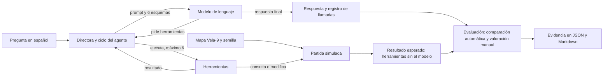
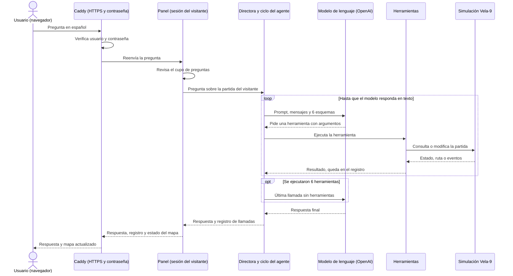

# Xenomorfo-Q

Agente "directora" que responde preguntas en español sobre una partida de sigilo simulada y actúa sobre ella usando herramientas.

**Curso:** SI3003 Inteligencia Artificial, Universidad EAFIT, 2026-2
**Fecha:** noviembre de 2026
**Opción del proyecto:** B, agente con herramientas

| Integrante | Usuario | Rol |
|---|---|---|
| Juan José Álvarez | jalvarez01 | Simulación (mapa, visión, rutas A*), herramientas, directora, panel y despliegue |
| Emmanuel Castaño | ecastanos23 | Ciclo del agente con límite de llamadas, configuración del modelo, esquemas y prompt |
| Santiago Meneses | SamCr17 | Alienígena por reglas y pistas, predicción de destino y avance con eventos |
| Simón Mazo | Smg4315 | Casos de prueba, valoración, análisis, metodología y diagramas |

## 1. Introducción

En un juego de sigilo, la "directora" es el sistema que conoce la posición real del jugador y decide cuándo ayudar a la criatura que lo persigue. Diseñarla y probarla obliga a revisar la partida a mano: dónde está cada personaje, cuántos pasos los separan, si la criatura ya vio al jugador y si conviene darle una pista.

Xenomorfo-Q automatiza esa revisión. Un modelo de lenguaje recibe la pregunta en español, decide qué herramientas usar sobre una simulación propia (la estación Vela-9), las ejecuta con un límite de llamadas y responde con datos reales de la partida. También puede actuar: dar una pista al alienígena o avanzar la simulación. Se eligió un agente con herramientas y no un sistema RAG porque las respuestas dependen de un estado que cambia en cada tick y de cálculos como rutas y distancias, no de documentos.

## 2. Objetivo

**General:** construir un agente con herramientas que responda preguntas sobre una partida simulada y actúe sobre ella, con respuestas verificables contra el estado real de la simulación.

**Específicos:**

1. Responder correctamente al menos 5 de los 6 casos de prueba en la corrida oficial, comparando cada respuesta con el valor calculado por las herramientas sin el modelo.
2. Respetar el límite de 6 herramientas ejecutadas por pregunta en el 100 % de los casos, y avisar al usuario cuando se alcanza.
3. Responder cada pregunta en menos de 5 segundos con el modelo por defecto.

## 3. Descripción de los datos

No se usan datos externos ni personales. Los datos son una simulación propia en Python y un mapa ficticio creado por el equipo.

| Elemento | Descripción |
|---|---|
| Fuente | Mapa ficticio Vela-9 en [data/mapas/](data/mapas/), creado por el equipo |
| Formato | Grilla de texto (`vela9.txt`) y archivo de anotación de salas (`vela9_salas.txt`) |
| Tamaño | 15 por 24 casillas, 8 salas, 8 casilleros, puertas entre salas |
| Salas | Médico, Laboratorio, Comunicaciones, Corredor A, Corredor B, Bodega, Reactor, Hangar |
| Estado de una partida | Posición del tripulante y del alienígena, dirección del alienígena, campo de visión, tick, pistas restantes, captura |
| Reproducibilidad | Cada partida se crea con una semilla fija (42 por defecto); la misma semilla da la misma partida |

- **Preprocesamiento:** el mapa se carga una vez y las salas se definen por anotación explícita (decisión D6). Los nombres de sala se comparan sin mayúsculas ni tildes (D14).
- **Limitaciones:** un solo mapa; el tripulante se mueve con un bot aleatorio y no puede esconderse en los casilleros; el alienígena sigue reglas fijas, no aprendidas.
- **Licencia:** mapa y simulación propios del equipo, de uso académico.

## 4. Metodología

1. **Preparación:** se carga el mapa Vela-9 y se crea una partida con semilla fija.
2. **Modelo:** la pregunta, el prompt de sistema (versión 2) y los esquemas de las 6 herramientas se envían al proveedor configurado: OpenAI con `gpt-5.4-nano` por defecto, o NVIDIA NIM como alternativa (D15). Temperatura 0 para que los casos sean lo más repetibles posible. El modelo no se entrena.
3. **Ejecución:** el ciclo del agente, basado en `run_agent_with_budget` de los notebooks del curso, ejecuta las herramientas que pide el modelo sobre la misma partida, le devuelve los resultados y registra cada llamada. Con 6 herramientas ejecutadas, el modelo responde una última vez sin herramientas y dice que alcanzó el límite (D9).
4. **Evaluación:** el resultado esperado de cada caso se calcula llamando a las herramientas sin el modelo, sobre una partida igual a la del caso. Una comparación automática busca los datos esperados en la respuesta y la valoración final es manual.
5. **Despliegue:** la directora se usa por comando (`python -m director`), notebook o un panel web, que también se publica en una instancia EC2 de AWS (D16, D18).

**Herramientas del agente:**

| Herramienta | Qué hace |
|---|---|
| `estado_partida` | Posición, sala y estado de cada personaje, tick y pistas restantes |
| `ruta_mas_corta` | Pasos y salas recorridas entre dos puntos, con A* y heurística Manhattan |
| `predecir_destino` | Sala hacia la que se dirige el tripulante, con su confianza, a partir de sus últimos 10 ticks |
| `ve_tripulante` | Si el alienígena ve al tripulante (cono de visión y línea de vista) y a qué distancia está |
| `dar_pista` | Le indica al alienígena una sala, nunca una casilla; máximo 3 por partida |
| `avanzar_simulacion` | Avanza de 1 a 20 ticks y devuelve los eventos ocurridos |

**Decisiones principales:**

- **Agente y no RAG:** el estado cambia en cada tick y las respuestas necesitan cálculos.
- **Límite de 6 herramientas por pregunta:** acota costo y latencia; cuenta herramientas ejecutadas, no turnos (D9).
- **Modelo `gpt-5.4-nano`:** fue el más barato que pasó las pruebas de herramientas, de llamada de cierre y del caso C1 en menos de 4 s (D15).
- **Métricas:** acierto por caso (datos esperados presentes en la respuesta), herramienta adecuada, número de llamadas, respeto del límite y latencia.

**Diagrama de flujo metodológico**



## 5. Diagrama de interacción (UML)

En producción, el panel corre en una instancia EC2 de AWS. Caddy es el único servicio expuesto a internet: da HTTPS y pide usuario y contraseña. El panel escucha solo dentro de la máquina, guarda una partida por visitante y limita las preguntas para acotar el costo del modelo. La clave del modelo vive solo en el servidor.

**Diagrama de secuencia de una pregunta en producción**



## 6. Resultados

**Corrida oficial** del 2026-11-12: `gpt-5.4-nano`, temperatura 0, prompt versión 2, semilla 42 (C3 usa una partida preparada con semilla 0 y 11 ticks). Evidencia completa en [experiments/resultados/casos_2026-11-12_prompt2_semilla42.md](experiments/resultados/casos_2026-11-12_prompt2_semilla42.md).

| Caso | Tipo | Pregunta | Esperado | Obtenido | Llamadas | Latencia (s) | Valoración |
|---|---|---|---|---|---|---|---|
| C1 | habitual | ¿En qué sala está el tripulante y a cuántos pasos está el alienígena? | Bodega, 15 pasos | Bodega, 15 pasos | 3 | 2.9 | Correcto |
| C2 | habitual | ¿El alienígena está viendo al tripulante en este momento? | No lo ve | No lo ve, a 15 casillas | 1 | 1.5 | Correcto |
| C3 | habitual | ¿Hacia qué sala se dirige el tripulante? | Hangar, confianza 0.5 | Hangar, confianza 0.5 | 1 | 2.1 | Correcto |
| C4 | varias herramientas | Dale una pista hacia la sala del tripulante, avanza 10 ticks y dime si se acercó | Pista a Bodega; de 15 a 6 pasos, sí se acercó | Dio la pista y avanzó, pero no midió la distancia antes | 4 | 4.9 | Parcial |
| C5 | límite: sala inexistente | ¿Cuántos pasos hay desde la Enfermería hasta el Hangar? | No existe; lista las 8 salas | Dice que no existe y lista las 8 salas | 1 | 1.9 | Correcto |
| C6 | límite de llamadas | Calcula la distancia del alienígena a cada una de las 8 salas | Responde con lo obtenido y avisa el límite | 5 distancias correctas y avisa el límite | 6 | 4.4 | Correcto |

**Cumplimiento de los objetivos:**

| Objetivo | Meta | Resultado |
|---|---|---|
| Casos correctos | Al menos 5 de 6 | 5 de 6 (C4 parcial) |
| Respeto del límite | 100 % | 100 %: en C6 se detuvo en 6 y lo avisó |
| Latencia | Menos de 5 s | De 1.5 a 4.9 s |

**Comparación con alternativas:**

| Alternativa | Resultado |
|---|---|
| Prompt versión 1 (línea base) | "enfermeria" sin tilde: respondía con la ruta de Médico (incorrecto 3 de 3); C4: parcial 3 de 3 |
| Prompt versión 2 (final) | "enfermeria": dice que no existe (correcto 3 de 3); C4: correcto en las 8 corridas de prueba y parcial en la oficial (8 de 9) |
| `meta/llama-3.3-70b-instruct` (NVIDIA NIM, modelo original) | Error 410: dado de baja el 2026-08-26 |
| `openai/gpt-oss-20b` (NVIDIA NIM) | Funciona, pero tarda unos 4 minutos por pregunta |
| `gpt-4o-mini` (OpenAI) | Respondió C1 con un número inventado |
| `gpt-5.4-nano` (OpenAI, elegido) | C1 correcto en menos de 4 s; el más barato de los que pasaron |

**Análisis.** La directora elige bien la herramienta en preguntas de una sola consulta (C1, C2, C3), no inventa datos cuando una herramienta falla (C5) y respeta el límite (C6). Las herramientas dan siempre el mismo resultado para la misma partida, así que los errores vienen de cómo el modelo las usa, no de los datos.

**Limitaciones:**

1. **Variación con temperatura 0:** C4 salió parcial en la corrida oficial y correcto en otras 8 corridas con el mismo prompt; una sola corrida por caso no basta para valorar.
2. **Llamadas de más:** en C6 el modelo gastó una de las 6 llamadas en `estado_partida`, que no hacía falta, y por eso solo alcanzó 5 salas.
3. **Dependencia del proveedor:** el modelo original dejó de existir; se resolvió haciendo configurable el proveedor (D15).
4. **Sin memoria entre preguntas:** cada pregunta es independiente, así que "¿y ahora?" no se entiende sin repetir el contexto.

**Mejoras propuestas:** aclarar en el esquema de `ve_tripulante` que la distancia se informa siempre; correr cada caso varias veces y reportar la tasa de acierto; una herramienta de distancias a todas las salas; y un historial corto de conversación.

**Panel visual.** Permite observar una partida, jugarla moviendo al tripulante con las flechas y preguntarle a la directora sobre esa misma partida, con niveles de dificultad Normal, Difícil y Pesadilla (D19). Los niveles existen solo en el panel; los casos usan siempre la partida normal.


## 7. Reproducibilidad

**Requisitos:** Python 3 (probado con 3.15), las dependencias de `requirements.txt` y una clave de OpenAI (o de NVIDIA NIM). Las pruebas no necesitan clave ni internet.

**Instalación:**

```bash
git clone https://github.com/jalvarez01/Xenomorfo-Q.git && cd Xenomorfo-Q
python3 -m venv .venv
source .venv/bin/activate        # Windows: .venv\Scripts\activate
pip install -r requirements.txt
cp .env.example .env             # completar OPENAI_API_KEY; nunca subir .env
pytest
```

**Ejecución:**

```bash
python -m director "¿En qué sala está el tripulante?" --registro   # una pregunta con su registro
python -m director                                                 # modo interactivo
python -m experiments.casos --semilla 42                           # los 6 casos y su evidencia
python -m panel --abrir                                            # panel en http://127.0.0.1:8000/
```

- **Colab:** abrir [notebooks/demo_directora.ipynb](notebooks/demo_directora.ipynb) y guardar `OPENAI_API_KEY` en los secretos del notebook.
- **AWS:** guía en [docs/despliegue.md](docs/despliegue.md).
- **Claves:** el proveedor se elige con `XQ_PROVEEDOR` (`openai` por defecto o `nvidia`). Las claves van solo en `.env` o en los secretos de Colab, nunca en el repositorio.

**Estructura del repositorio:**

```text
Xenomorfo-Q/
├── sim/              Simulación: entorno, mapa, visión, rutas A* y avance con eventos
├── alien/            Alienígena por reglas y pistas
├── director/         Directora: ciclo del agente, herramientas, esquemas, prompt y modelo
├── panel/            Panel web local (servidor y página)
├── experiments/      Ejecutor de casos y evidencia oficial en resultados/
├── notebooks/        Notebook de demostración
├── data/mapas/       Mapa Vela-9 y anotación de salas
├── deploy/           Despliegue en AWS EC2 con Caddy
├── docs/             Arquitectura, contratos, decisiones, casos y propuesta
└── tests/            Pruebas automáticas sin red
```

**Fuentes:** ciclo del agente basado en los notebooks del curso ([Lecture11](https://github.com/EAFIT-IA/si3003-artificial-intelligence/tree/main/notebooks/Lecture11)); bibliotecas `numpy`, `openai`, `python-dotenv` y `pytest`. La documentación técnica completa está en [docs/README.md](docs/README.md) y las decisiones de diseño en [docs/decisiones.md](docs/decisiones.md).
