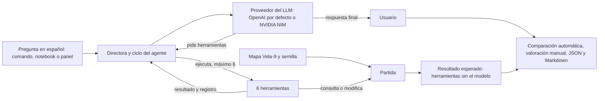
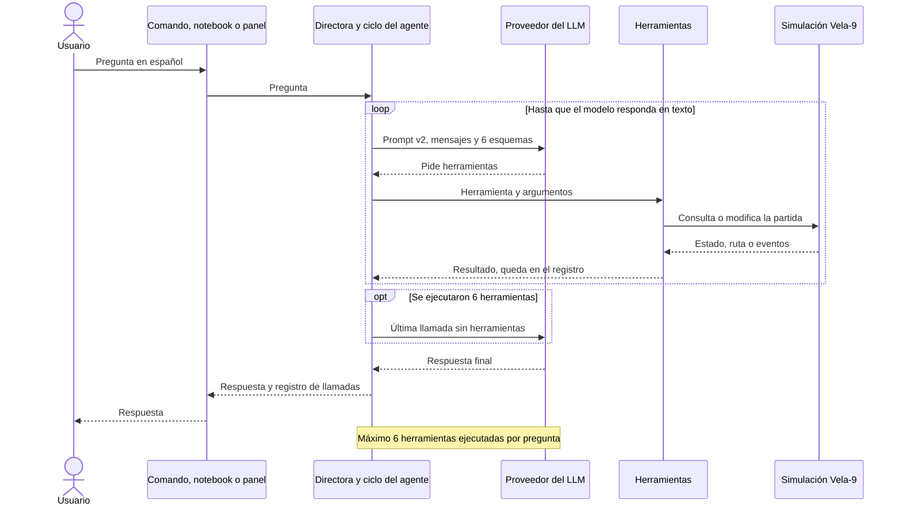
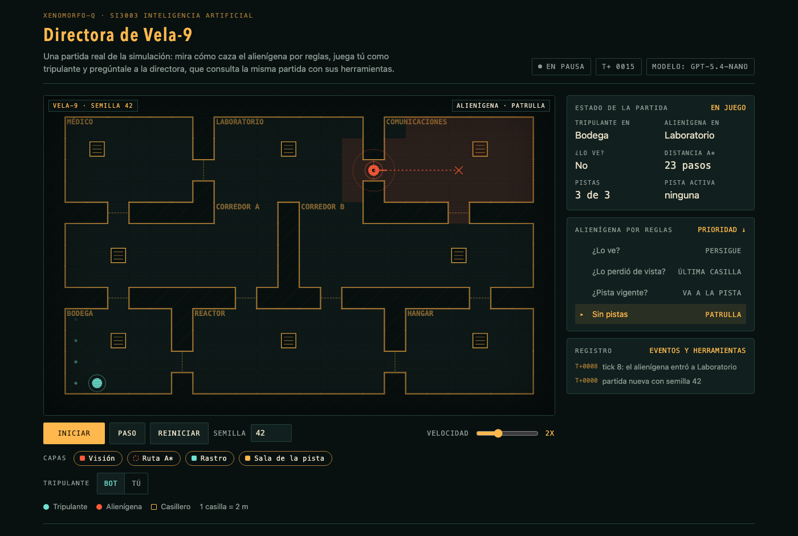

# Xenomorfo-Q

Agente directora que responde preguntas sobre una partida de sigilo simulada y actúa sobre ella usando herramientas.

Proyecto final de **SI3003 Inteligencia Artificial**, Universidad EAFIT, 2026-2.

## Integrantes

| Integrante | Usuario | Rol |
|---|---|---|
| Juan José Álvarez | jalvarez01 | Simulación (mapa, salas, visión, rutas con A*), herramientas del agente, directora y comando |
| Emmanuel Castaño | ecastanos23 | Ciclo del agente con límite de llamadas, configuración del modelo de lenguaje, esquemas y prompt de sistema |
| Santiago Meneses | SamCr17 | Alienígena por reglas y pistas, predicción de destino y avance de la simulación con eventos |
| Simón Mazo | Smg4315 | Casos de prueba, valoración, análisis, notebook de demostración y README final |

## Problema

En un juego de sigilo, la directora conoce la posición real del jugador y decide cuándo ayudar a la criatura que lo persigue. Diseñarla y probarla obliga a revisar la partida a mano: dónde está cada uno, cuántos pasos los separan, si la criatura ya vio al jugador y si conviene darle una pista. Xenomorfo-Q es un agente que responde esas preguntas en español consultando una simulación con herramientas, y que puede dar pistas o avanzar la partida.

## Opción elegida y por qué

Opción B: agente con herramientas. Las respuestas dependen de un estado que cambia en cada tick y de cálculos como rutas y distancias, no de documentos; un sistema RAG no puede consultar ese estado ni actuar sobre la partida.

Cómo cumple la opción B:

- **Herramientas:** 6 funciones de Python sobre la simulación: `estado_partida`, `ruta_mas_corta`, `predecir_destino`, `ve_tripulante`, `dar_pista` y `avanzar_simulacion` ([docs/herramientas.md](docs/herramientas.md)).
- **Descripciones para el modelo:** cada herramienta tiene un esquema con su descripción y sus parámetros en `director/esquemas.py`, y el prompt de sistema explica cuándo usar cada una (`director/prompt.py`).
- **Ciclo de ejecución:** `director/agente.py` envía la pregunta y los esquemas al modelo, ejecuta las herramientas que pide, le devuelve los resultados y repite hasta que responde en texto ([docs/arquitectura.md](docs/arquitectura.md)).
- **Límite de llamadas:** como máximo 6 herramientas ejecutadas por pregunta. Al llegar al límite, las llamadas que sobran no se ejecutan y el modelo responde una última vez sin herramientas, diciendo que alcanzó el límite (decisión D9 en [docs/decisiones.md](docs/decisiones.md)).
- **Registro:** cada llamada queda registrada con la herramienta, los argumentos, el resultado y el tiempo; `python -m director --registro` y el notebook lo muestran.

## Metodología

1. **Preparación:** se carga el mapa Vela-9 y se crea una partida nueva con semilla fija (42 por defecto).
2. **Modelo:** la pregunta en español, el prompt de sistema (versión 2, `director/prompt.py`) y los esquemas de las 6 herramientas (`director/esquemas.py`) se envían al proveedor configurado: OpenAI con `gpt-5.4-nano` por defecto, o NVIDIA NIM con `openai/gpt-oss-20b` (D15). El cliente es la biblioteca `openai`, limitada a la serie 2.x (D17), con temperatura 0. El modelo no se entrena en este proyecto.
3. **Ejecución:** el ciclo del agente (`director/agente.py`, basado en `run_agent_with_budget` de Lecture11) ejecuta las herramientas que pide el modelo sobre la misma partida, le devuelve los resultados y registra cada llamada. Cuenta las herramientas ejecutadas, no los turnos: con 6 ya ejecutadas, las que sobran no se ejecutan y el modelo responde una última vez sin herramientas, diciendo que alcanzó el límite (D9).
4. **Evaluación:** el resultado esperado de cada caso se calcula llamando a las herramientas directamente, sin el modelo, sobre una partida nueva igual a la del caso (semilla 42; C3 usa la preparación semilla 0 y 11 ticks). La respuesta se contrasta con ese valor: una comparación automática busca los datos esperados en el texto y la valoración final es manual. También se revisan las herramientas y los argumentos usados, los errores y si se alcanzó el límite.
5. **Salida:** la respuesta llega al usuario por el comando `python -m director`, el notebook o el panel (D16). El ejecutor de casos guarda la evidencia en JSON y Markdown en `experiments/resultados/`.

Las distancias son rutas A* sobre la grilla y `predecir_destino` analiza los últimos 10 ticks del tripulante. La referencia es el estado real de la simulación, no un benchmark externo: sirve para contrastar las respuestas con la partida, pero usa las mismas herramientas del proyecto, así que no es una implementación independiente.

**Flujo metodológico**



**Diagrama de secuencia de una pregunta**



## Instrucciones de ejecución

### En local

```bash
python3 -m venv .venv
source .venv/bin/activate        # Windows: .venv\Scripts\activate
pip install -r requirements.txt
pytest
```

Las pruebas no llaman a la API real.

Para preguntarle a la directora hace falta la clave (ver "Configuración de la clave"):

```bash
python -m director "¿En qué sala está el tripulante?" --registro
python -m director
```

La primera forma responde una pregunta; con `--registro` muestra también cada llamada a herramienta y el número de llamadas. La segunda abre el modo interactivo sobre una misma partida: `estado` muestra el estado sin usar el modelo y `salir` termina. Las opciones `--semilla` (por defecto 42) y `--limite` (por defecto 6) cambian la partida y el máximo de llamadas. El detalle está en [docs/herramientas.md](docs/herramientas.md).

Para correr los 6 casos de prueba y guardar la evidencia (JSON y Markdown) en `experiments/resultados/`:

```bash
python -m experiments.casos --semilla 42
```

### En Colab

Abrir [notebooks/demo_directora.ipynb](notebooks/demo_directora.ipynb) en Colab y guardar la clave en los secretos del notebook (icono de llave) con el nombre de su variable: `OPENAI_API_KEY` (por defecto), o `NVIDIA_API_KEY` junto con el secreto `XQ_PROVEEDOR` con el valor `nvidia`. La primera celda clona el repositorio, instala las dependencias y carga la clave sin mostrarla. El notebook muestra las herramientas sin el modelo, cuatro preguntas con su registro de llamadas y qué pasa al llegar al límite; está guardado con las salidas de una ejecución real. En local funciona igual, con la clave en `.env`.

## Panel visual

Un panel web local para ver y jugar una partida de Vela-9 y hablar con la directora sobre esa misma partida. Es una ayuda visual para la demostración: la rúbrica no exige interfaz gráfica, y el agente, las herramientas y la evidencia oficial no cambian (decisión D16).

```bash
python -m panel                          # http://127.0.0.1:8000/
python -m panel --semilla 7 --puerto 8080 --abrir
```

- **Observar:** Iniciar, Pausar, Paso, Reiniciar con semilla y velocidad. Cada tick avanza con el mismo avance que usa la herramienta `avanzar_simulacion`, con el alienígena por reglas.
- **Tú:** mueves al tripulante con las flechas, WASD o los botones; cada movimiento es un tick. Los casilleros no esconden porque la simulación no lo implementa.
- **Dificultad:** Normal, Difícil o Pesadilla, junto a la semilla; cambiarla reinicia la partida con la misma semilla y el nivel se ve en la etiqueta del mapa y en `/api/estado` (decisión D19).
  - **Normal** es la partida de siempre y el valor por defecto.
  - **Difícil:** el alienígena ve hasta 10 casillas y, mientras persigue, da un paso extra cada 3 ticks.
  - **Pesadilla:** Difícil más una pista automática hacia la sala real del tripulante tras 25 ticks sin verlo (como máximo 3, aparte de las 3 de la directora).
  - La directora del chat responde sobre la misma partida, con la visión del nivel.
  - Los niveles existen solo en el panel: los casos, `python -m director`, el notebook y la evidencia oficial usan siempre la partida normal.
- **Mapa:** paredes, puertas, casilleros y salas del mapa real; tripulante y alienígena en sus posiciones, la dirección del alienígena, su campo de visión real, la ruta A* hacia su objetivo, el rastro del tripulante y la sala de la pista vigente.
- **Instrumentos:** tick, sala de cada personaje, si lo ve, distancia A* en pasos, pistas restantes, pista activa, rama activa del alienígena por reglas, captura y un registro con los eventos del avance y las llamadas de la directora.
- **Chat:** la pregunta va a `Directora.preguntar` sobre la partida del mapa; se ven la respuesta y cada llamada con sus argumentos y resultado, y el mapa se actualiza si la directora da una pista o avanza la simulación. Trae las preguntas de los casos C1 a C4 como ejemplos.

Escucha solo en `127.0.0.1`, no usa nada de internet salvo la llamada al modelo desde el servidor, y la clave nunca llega al navegador. Sin clave, el mapa y el juego funcionan y el chat muestra el mismo mensaje de configuración que `python -m director`.



A 1440x900 y a 1366x768 la caja de pregunta y la respuesta más reciente quedan al lado del mapa sin desplazar la página; el historial se desplaza dentro del panel del chat. Después de preguntar C4 en el chat, el mapa muestra la pista hacia Bodega y el avance de 10 ticks: [captura del chat](docs/img/panel_chat.png). La respuesta de esa captura salió parcial (no comparó la distancia antes y después), la misma variación de C4 que se describe en el análisis.

## Panel en línea

El panel también se puede publicar en internet, en una instancia EC2 de AWS con Ubuntu 24.04 detrás de Caddy (decisión D18). La guía paso a paso está en [docs/despliegue.md](docs/despliegue.md) y los archivos en [deploy/](deploy/).

- Caddy es lo único que escucha en internet: da HTTPS con un dominio `<ip>.sslip.io` y pide usuario y contraseña en todo salvo `/salud`. El panel sigue escuchando solo en `127.0.0.1`.
- Cada visitante tiene su propia partida, por una cookie de sesión: como máximo 30 sesiones, que duran 30 minutos sin uso.
- El chat tiene cupos para acotar el costo del modelo: 20 preguntas por sesión y 60 por hora en todo el servidor (`XQ_PANEL_MAX_SESION`, `XQ_PANEL_MAX_HORA`; 0 desactiva). Pasado un cupo, el chat avisa y el mapa y el modo Tú siguen funcionando. En local rigen los mismos cupos.
- `GET /salud` responde `{"ok": true}` para comprobar que el servicio está vivo, y `python -m panel` toma el puerto de `PORT` si no se pasa `--puerto`.
- La clave del modelo vive solo en `/etc/xenomorfo-q.env` del servidor, con permisos 600.

## Configuración de la clave

El proveedor del modelo se elige con `XQ_PROVEEDOR` (decisión D15 en [docs/decisiones.md](docs/decisiones.md)):

| Proveedor | `XQ_PROVEEDOR` | Clave | Modelo por defecto | Nota |
|---|---|---|---|---|
| OpenAI (principal) | `openai` | `OPENAI_API_KEY` | `gpt-5.4-nano` | De pago por uso; respuestas en unos 2 a 3 s. |
| NVIDIA NIM (alternativa) | `nvidia` | `NVIDIA_API_KEY` | `openai/gpt-oss-20b` | Gratuita con cuenta en build.nvidia.com; en nuestras pruebas tardó unos 4 minutos por pregunta. |

- En local: copiar `.env.example` a `.env`, poner `XQ_PROVEEDOR` y completar la clave de ese proveedor. Para cambiar de proveedor basta con cambiar `XQ_PROVEEDOR`; `XQ_MODELO` cambia el modelo.
- En Colab: guardar la clave en los secretos del notebook con el nombre de su variable (`OPENAI_API_KEY` o `NVIDIA_API_KEY`).
- Con OpenAI, conviene fijar un límite de gasto mensual bajo en la configuración de la cuenta: los casos y la demostración hacen pocas llamadas, y el límite evita sorpresas si la clave se filtra.
- Nunca subir `.env` ni una clave al repositorio.

## Fuentes y herramientas

- **Datos:** simulación propia en Python y mapa ficticio Vela-9 (15 por 24 casillas, 8 salas y 8 casilleros) en [data/mapas/](data/mapas/). No se usan datos externos ni personales.
- **Modelo:** `gpt-5.4-nano` de OpenAI por defecto, con temperatura 0 para que los casos sean lo más repetibles posible; NVIDIA NIM queda como alternativa gratuita configurable (D15).
- **Base del ciclo del agente:** los notebooks del curso de [Lecture11](https://github.com/EAFIT-IA/si3003-artificial-intelligence/tree/main/notebooks/Lecture11) (`run_agent_with_budget`).
- **Algoritmos propios:** visión con línea de vista (Bresenham) y cono, rutas con A* y heurística Manhattan, predicción de destino por acercamiento y alienígena por reglas ([docs/decisiones.md](docs/decisiones.md)).
- **Bibliotecas de Python:** `numpy` (mapa y visión), `openai` (cliente para OpenAI y NVIDIA NIM, que es compatible), `python-dotenv` (claves desde `.env`), `pytest` (pruebas sin red) y Jupyter para el notebook.

## Casos de prueba

Cinco casos que pide la rúbrica (3 habituales, 1 que exige varias herramientas y 1 límite) y uno extra para mostrar el límite de llamadas. El resultado esperado se calcula con las herramientas sin el modelo, sobre la misma partida ([docs/casos.md](docs/casos.md)). Cada caso corre en una partida nueva con la semilla 42; C3 usa una partida preparada (semilla 0, 11 ticks) para que el tripulante ya se esté moviendo.

Resultados de la corrida oficial del 2026-11-12 con `gpt-5.4-nano`, temperatura 0 y prompt versión 2. La evidencia completa (llamadas con argumentos y resultados, respuesta, latencia y comparación automática) está en [experiments/resultados/casos_2026-11-12_prompt2_semilla42.md](experiments/resultados/casos_2026-11-12_prompt2_semilla42.md) y su `.json`.

| Caso | Tipo | Pregunta | Resultado esperado | Respuesta obtenida (resumen) | Llamadas | Valoración |
|---|---|---|---|---|---|---|
| C1 | habitual | ¿En qué sala está el tripulante y a cuántos pasos está el alienígena? | Bodega, a 15 pasos | "El tripulante está en Bodega. El alienígena está a 15 pasos" (con la ruta Médico, Corredor A, Bodega) | 3 | Correcto |
| C2 | habitual | ¿El alienígena está viendo al tripulante en este momento? | No lo ve; está a 15 pasos | "No. En este momento el alienígena no está viendo al tripulante. Distancia actual: 15 casillas" | 1 | Correcto |
| C3 | habitual | ¿Hacia qué sala se dirige el tripulante? | Hacia el Hangar (está en el Corredor B), confianza 0.5 | "Parece dirigirse a Hangar", con confianza 0.5, acercamiento de 5 casillas y 10 ticks analizados | 1 | Correcto |
| C4 | varias herramientas y acción | El alienígena lleva rato perdido: dale una pista hacia la sala donde está el tripulante, avanza 10 ticks y dime si se acercó. | Pista a Bodega (quedan 2); pasa de 15 a 6 pasos, sí se acercó | Dio la pista a Bodega, avanzó 10 ticks y listó los eventos, pero dijo que no podía confirmar si se acercó: no midió la distancia antes | 4 | Parcial |
| C5 | límite: sala inexistente | ¿Cuántos pasos hay desde la Enfermería hasta el Hangar? | La Enfermería no existe; lista las 8 salas válidas sin inventar una ruta | "La sala Enfermería no existe", lista las 8 salas y pregunta si se refería a Médico, sin calcular | 1 (error de la herramienta) | Correcto |
| C6 | extra: límite de llamadas | Calcula la distancia del alienígena a cada una de las 8 salas. | Necesita 8 llamadas; con el límite de 6 debe responder con lo obtenido y decir que alcanzó el límite | Distancias correctas a 5 salas (0, 8, 16, 6 y 14 pasos) y dice que alcanzó el límite, sin inventar las otras 3 | 6 (límite) | Correcto |

Resumen: 5 de 6 correctos y C4 parcial. Las latencias fueron de 1.5 a 4.9 s por pregunta.

## Análisis de resultados

<!-- borrador para revisión de Simón -->

**Lo que funciona.** La directora elige bien la herramienta en los casos de una sola consulta (C1, C2, C3), no inventa datos cuando una herramienta falla (C5) y respeta el límite de llamadas: en C6 se detiene en 6, responde con lo que obtuvo y dice que alcanzó el límite (D9). Las herramientas dan siempre el mismo resultado para la misma partida, así que los errores están en cómo el modelo las usa, no en los datos.

**Errores y limitaciones observados en las pruebas reales:**

1. **El modelo original dejó de existir.** La primera llamada real a `meta/llama-3.3-70b-instruct` en NVIDIA NIM respondió 410: llegó al fin de su vida el 2026-08-26. De los modelos alternativos de NIM, tres respondieron 404 para nuestra cuenta y el único que funcionó tardó unos 4 minutos por pregunta. Se resolvió haciendo configurable el proveedor y usando OpenAI como principal (D15). Lección: un prototipo que depende de un modelo externo necesita poder cambiarlo sin tocar el código.
2. **Cambio silencioso de una sala inexistente.** Con el prompt versión 1, "¿Cuántos pasos hay desde la enfermeria hasta el Hangar?" (sin tilde) respondía "Hay 20 pasos desde Médico hasta Hangar" en 3 de 3 corridas: el modelo tradujo "enfermeria" a Médico antes de llamar a la herramienta, justo lo que D12 quería evitar. Con "Enfermería" con tilde no pasaba. La versión 2 del prompt lo prohíbe con un ejemplo explícito y desde entonces responde que la sala no existe (3 de 3).
3. **Variación con temperatura 0 en C4.** En la corrida oficial C4 quedó parcial: no midió la distancia antes de la pista y afirmó, sin razón, que `ve_tripulante` solo da la distancia cuando ve al tripulante. Con el mismo prompt, en otras 8 corridas respondió bien (de 15 a 6 casillas, sí se acercó). La temperatura 0 reduce la variación, pero no la elimina: una sola corrida por caso no basta para valorar.
4. **Llamadas de más.** En C1 el modelo pidió `ruta_mas_corta` y además `ve_tripulante`, que da el mismo número; en C6 gastó una de las 6 llamadas en `estado_partida`, que no hacía falta. Con un límite de 6, cada llamada sobrante es una sala menos en C6.
5. **Sin memoria entre preguntas.** Cada pregunta es independiente: la partida conserva su estado, pero el modelo no recuerda la pregunta anterior, así que "¿y ahora?" no se entiende sin repetir el contexto.

**Mejoras concretas:**

1. Aclarar en la descripción de `ve_tripulante` que `distancia_casillas` se informa siempre, lo vea o no. Ataca directamente el error de C4 en la corrida oficial.
2. Correr cada caso varias veces (por ejemplo 5) y reportar la tasa de acierto en vez de una sola corrida; el ejecutor ya guarda todo lo necesario para hacerlo.
3. Agregar una herramienta que dé la distancia a todas las salas de una vez, o permitir varios destinos en `ruta_mas_corta`, para que preguntas como C6 quepan en el límite.
4. Guardar un historial corto de la conversación para permitir preguntas de seguimiento.

## Documentación

- [Índice de la documentación](docs/README.md)
- [Propuesta](docs/propuesta.md): problema, opción elegida, herramientas, alcance y plan de pruebas.
- [Arquitectura](docs/arquitectura.md): partes del sistema, flujo de una pregunta y ciclo con límite.
- [Contratos](docs/contratos.md): interfaces del entorno, las herramientas y el agente.
- [Herramientas](docs/herramientas.md): las 6 herramientas, la partida, la directora y el comando `python -m director`.
- [Casos](docs/casos.md): el ejecutor de casos, los valores esperados y el formato de la evidencia.
- [Alienígena](docs/alien.md): el alienígena por reglas y las pistas.
- [Predicción](docs/prediccion.md): la heurística de `predecir_destino`.
- [Avance](docs/avance.md): el avance de la simulación con eventos.
- [Entorno](docs/entorno.md): mapas, salas, reglas, bot provisional y limitaciones de la versión 0.
- [Decisiones](docs/decisiones.md): registro de decisiones de diseño.
- [Guía de desarrollo](docs/guia-desarrollo.md): instalación, ramas, PR, claves de API y estándar de documentación.
- [Despliegue](docs/despliegue.md): el panel en una instancia EC2 de AWS detrás de Caddy.

## Flujo de trabajo

- Las ramas de trabajo (`feature/...`, `fix/...`, `docs/...`) salen de `development`.
- Todo entra a `development` por Pull Request con la aprobación de otro integrante.
- Cada integrante hace sus propios commits.
