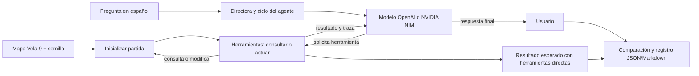
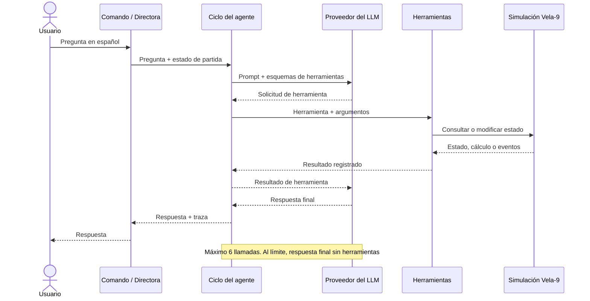

# Xenomorfo-Q

**Equipo:** Juan José Álvarez, Emmanuel Castaño, Santiago Meneses y Simón Mazo

**Curso:** SI3003 Inteligencia Artificial, Universidad EAFIT, 2026-2

**Fecha:** 12 de noviembre de 2026

| Integrante | Rol |
|---|---|
| Juan José Álvarez | Simulación y funciones de las herramientas |
| Emmanuel Castaño | Ciclo del agente, configuración del modelo de lenguaje y prompt de sistema |
| Santiago Meneses | Alienígena por reglas, predicción de destino y avance de la simulación |
| Simón Mazo | Casos de prueba, análisis, notebook de demostración y README final |

## 1. Introducción

En un juego de sigilo, la directora conoce el estado real de la partida y decide cuándo ayudar a la criatura que persigue al jugador. Inspeccionar manualmente posiciones, rutas, visión y eventos hace más lento el diseño y la prueba de ese comportamiento. Xenomorfo-Q implementa una directora conversacional en español que consulta una simulación propia y puede actuar sobre ella.

El proyecto aporta un agente con herramientas para inspeccionar el mapa Vela-9, calcular rutas, estimar el destino del tripulante, dar pistas al alienígena y avanzar la partida. Se eligió un agente con herramientas (opción B), no RAG: la respuesta depende de un estado cambiante y de cálculos que no están contenidos en documentos.

## 2. Objetivo

**Objetivo general:** Implementar y evaluar una directora conversacional que responda preguntas y ejecute acciones sobre una partida reproducible de sigilo.

**Objetivos específicos:**

1. Exponer seis herramientas para consultar el estado, calcular rutas y visión, predecir destinos y actuar sobre la simulación.
2. Evaluar cinco casos de prueba requeridos y un caso adicional con semilla fija, registrando respuestas y llamadas a herramientas.
3. Verificar el límite de seis llamadas por pregunta y comparar las respuestas con los resultados de la simulación.

## 3. Descripción de los datos

No se usan conjuntos de datos de entrenamiento ni datos personales o externos. La entrada es una simulación propia y determinista con semilla fija; su mapa ficticio Vela-9 está representado en archivos de texto.

| Fuente | Tamaño y formato | Variables o contenido principal |
|---|---|---|
| `data/mapas/vela9.txt` y `data/mapas/vela9_salas.txt` | Mapa de 15 × 24 casillas; texto plano | Pasillos, paredes, puertas y distribución de las 8 salas |
| Estado generado por `sim/` | Una partida por semilla | Posiciones, salas, tick, visión, trayectorias, rutas y eventos |
| Estado de la directora | Registro JSON por caso | Pregunta, respuesta, herramientas, argumentos, resultados, llamadas y latencia |

El mapa se carga desde los archivos del proyecto, sin limpieza de datos externa. La semilla predeterminada es 42. Las pruebas usan el mapa ficticio y las reglas actuales del simulador; por tanto, no representan el comportamiento de jugadores reales. El repositorio no especifica una licencia de reutilización de datos o código.

## 4. Metodología

1. **Preparación:** cargar el mapa y crear una partida nueva con semilla fija.
2. **Modelado y operación:** enviar la pregunta en español, los esquemas de las seis herramientas y el prompt de sistema a `gpt-5.4-nano`, mediante OpenAI. También es posible configurar NVIDIA NIM; el modelo anterior `meta/llama-3.3-70b-instruct` fue retirado. El modelo se consulta con temperatura 0 y no se entrena en este proyecto. El ciclo del agente parte de los notebooks del curso [Lecture11](https://github.com/EAFIT-IA/si3003-artificial-intelligence/tree/main/notebooks/Lecture11).
3. **Ejecución:** el ciclo del agente valida y ejecuta las herramientas sobre la misma partida, conserva una traza y limita cada pregunta a seis llamadas.
4. **Evaluación:** contrastar la respuesta y la traza con el resultado esperado calculado directamente desde las herramientas sobre una partida nueva con la misma semilla. Se revisan la corrección del contenido, las herramientas/argumentos, los errores y si se alcanzó el límite.
5. **Salida:** devolver la respuesta al usuario y guardar la evidencia de los casos en JSON y Markdown.

Se usan rutas A* para las distancias y un predictor de destino basado en los últimos 10 ticks. El límite de seis llamadas acota ciclos y costos; al alcanzarlo, el agente debe responder sin herramientas y comunicar la limitación. La comparación principal es contra el estado real del simulador, no contra una métrica de clasificación o un benchmark externo.

**Flujo metodológico**



## 5. Diagrama de interacción (UML)

En ejecución, el usuario envía una pregunta al comando o modo interactivo. La directora entrega al modelo los esquemas disponibles; las llamadas solicitadas se ejecutan en la partida y sus resultados regresan al modelo. Al llegar al límite, el ciclo solicita una respuesta final sin herramientas.



## 6. Resultados

Los siguientes son **valores esperados de referencia** calculados con las herramientas del simulador para la semilla 42; no son una afirmación de que el modelo haya respondido correctamente. La tasa de aciertos del modelo se calcula solo después de comparar sus respuestas observadas con estos valores.

| Caso | Resultado esperado con semilla 42 |
|---|---|
| C1 | Tripulante en Bodega; alienígena a 15 pasos |
| C2 | El alienígena no ve al tripulante; distancia de 15 casillas |
| C3 | Bodega; confianza 0, acercamiento 0 y 0 ticks analizados |
| C4 | Pista a Bodega; distancia de 15 a 6 pasos; se acercó, no hubo captura; quedan 2 pistas |
| C5 | Enfermería no existe; se espera informar el error y las salas válidas |
| C6 (extra) | Se necesitan 8 llamadas de ruta para las 8 salas; con límite 6 se espera informar el límite y no inventar distancias faltantes |

### Ejecución observada

El 12 de noviembre de 2026 se ejecutaron C1–C5 y, por separado, C6 con `gpt-5.4-nano`, prompt versión 1, temperatura 0, semilla 42 y límite de 6 llamadas. La siguiente valoración manual exige responder lo solicitado y expresar la incertidumbre; para C6 se evalúa el comportamiento ante el límite. No es una comparación entre modelos ni una medida estadística general.

| Caso y evidencia | Respuesta observada frente a la referencia | Valoración |
|---|---|---|
| [C1](experiments/resultados/gpt-5.4-nano_semilla42_p7wc9j8x/C1/casos_2026-11-12_prompt1_semilla42.json) | Bodega y 15 pasos; usó `estado_partida` y `ve_tripulante`, que también devuelve la distancia. | Correcto |
| [C2](experiments/resultados/gpt-5.4-nano_semilla42_p7wc9j8x/C2/casos_2026-11-12_prompt1_semilla42.json) | No lo ve; 15 casillas. | Correcto |
| [C3](experiments/resultados/gpt-5.4-nano_semilla42_p7wc9j8x/C3/casos_2026-11-12_prompt1_semilla42.json) | Dio Bodega y confianza 0, pero sugirió un destino sin aclarar que no había movimiento analizado. | Incompleto: interpretación incierta |
| [C4](experiments/resultados/gpt-5.4-nano_semilla42_p7wc9j8x/C4/casos_2026-11-12_prompt1_semilla42.json) | Dio la pista y avanzó 10 ticks; informó 6 casillas, pero no midió la distancia inicial ni respondió si se acercó. | Incorrecto: falta la comparación solicitada |
| [C5](experiments/resultados/gpt-5.4-nano_semilla42_p7wc9j8x/C5/casos_2026-11-12_prompt1_semilla42.json) | Reconoció la sala inexistente y enumeró las salas válidas sin inventar una distancia. | Correcto |
| [C6](experiments/resultados/gpt-5.4-nano_C6_semilla42_8eo48bop/casos_2026-11-12_prompt1_semilla42.json) | Alcanzó 6 llamadas, informó cinco distancias correctas e identificó las tres faltantes y el límite. | Correcto para la prueba del límite; solicitud incompleta |

Con este criterio estricto, **3 de 5 casos (60 %) fueron correctos** en esa ejecución; C3 y C4 no cumplen completamente. La referencia usa las mismas herramientas del proyecto sin el modelo, por lo que permite contrastar la respuesta con el estado simulado, pero no es una implementación independiente.

En C3, el tick 0 no tiene historial de movimiento y no permite inferir un destino: una mejora sería que el agente explicite la falta de evidencia, y evaluar otra partida después de avanzar. En C4, una mejora sería exigir la medición de distancia antes y después de avanzar y reportar la comparación. C6 confirmó el límite en esta ejecución, pero no completó la solicitud de ocho distancias; se evalúa por separado de la tasa de C1–C5.

## 7. Reproducibilidad

**Requisitos:** Python 3, dependencias de `requirements.txt` y la clave del proveedor para consultar el modelo. Las pruebas automatizadas no llaman a la API real.

```bash
python3 -m venv .venv
source .venv/bin/activate        # Windows: .venv\Scripts\activate
pip install -r requirements.txt
pytest
```

Para OpenAI, copiar `.env.example` a `.env`, configurar `XQ_PROVEEDOR=openai`, `XQ_MODELO=gpt-5.4-nano` y completar `OPENAI_API_KEY`; en Colab, usar los secretos del notebook. Para NVIDIA, usar `XQ_PROVEEDOR=nvidia`, `NVIDIA_API_KEY` y un modelo disponible. No subir claves ni `.env` al repositorio.

```bash
python -m director "¿En qué sala está el tripulante?" --registro
python -m director
python -m experiments.casos
```

Con `--registro`, el comando muestra las llamadas a herramientas y su cantidad. Sin pregunta, `python -m director` abre el modo interactivo: `estado` muestra el estado sin usar el modelo y `salir` termina. Las opciones `--semilla` (42 por defecto) y `--limite` (6 por defecto) controlan la partida y el máximo de llamadas. El comando de casos usa semilla 42 por defecto y escribe JSON y Markdown en `experiments/resultados/`; requiere la clave de API. Para cambiar semilla o carpeta: `python -m experiments.casos --semilla 7 --salida otra/carpeta`. Los resultados incluyen modelo, temperatura, configuración, llamadas y respuestas; nunca incluyen la clave.

Para ejecutar y revisar los cinco casos de la rúbrica y el caso adicional C6 en Jupyter o Google Colab, abrir [Xenomorfo_Q_casos.ipynb](Xenomorfo_Q_casos.ipynb) y seguir las celdas en orden. El notebook usa OpenAI por defecto y registra el modelo utilizado.

| Ruta | Contenido |
|---|---|
| `director/` | Directora, ciclo del agente, cliente LLM, prompt y herramientas |
| `sim/`, `alien/` | Simulación, mapa, rutas, avance y comportamiento del alienígena |
| `data/mapas/` | Mapas de Vela-9 |
| `experiments/`, `tests/` | Ejecutor de casos y pruebas automatizadas |
| `docs/` | Documentación técnica y decisiones del proyecto |

Más información: [índice de documentación](docs/README.md), [propuesta](docs/propuesta.md), [arquitectura](docs/arquitectura.md), [contratos](docs/contratos.md), [herramientas](docs/herramientas.md), [entorno](docs/entorno.md), [decisiones](docs/decisiones.md) y [guía de desarrollo](docs/guia-desarrollo.md). Las ramas `feature/...`, `fix/...` y `docs/...` salen de `development`; los cambios entran por Pull Request con aprobación de otro integrante y cada persona hace sus propios commits.

## 8. Documentación casos de prueba

La batería contiene los cinco casos requeridos por la rúbrica —tres habituales, uno que exige varias herramientas y una acción, y uno de límite/entrada inexistente— más C6, un caso adicional para probar el máximo de llamadas. Cada caso usa una directora y una partida nuevas con la misma semilla, de modo que las acciones de C4 no alteren los demás.

| Caso | Tipo y pregunta | Herramientas esperadas | Criterio de comparación |
|---|---|---|---|
| C1 | Habitual: ¿En qué sala está el tripulante y a cuántos pasos está el alienígena? | `estado_partida`, `ruta_mas_corta` | Bodega y 15 pasos |
| C2 | Habitual: ¿El alienígena está viendo al tripulante en este momento? | `ve_tripulante` | No lo ve; 15 casillas |
| C3 | Habitual: ¿Hacia qué sala se dirige el tripulante? | `predecir_destino` | Bodega, confianza 0; al tick 0 aún no hay movimiento que permita inferir destino |
| C4 | Varias herramientas y acción: dar pista hacia la sala del tripulante, avanzar 10 ticks e indicar si se acercó | `estado_partida`, `dar_pista`, `avanzar_simulacion`, `ruta_mas_corta` | Bodega; distancia 15 → 6; sí se acercó; no capturado; 2 pistas restantes |
| C5 | Límite/entrada inexistente: ¿Cuántos pasos hay desde la Enfermería hasta el Hangar? | `ruta_mas_corta` | Informar que Enfermería no existe y listar las salas válidas; no inventar una distancia |
| C6 | Extra, límite de llamadas: calcular la distancia del alienígena a cada una de las 8 salas | `ruta_mas_corta` | Se requieren 8 llamadas con un presupuesto de 6; informar que se alcanzó el límite |

**Ejecución y evidencia.** Con la clave configurada, ejecutar `python -m experiments.casos` (semilla 42) o `python -m experiments.casos --semilla 42 --salida experiments/resultados`. El ejecutor calcula el resultado esperado directamente con las herramientas, ejecuta cada pregunta con el modelo y guarda por caso la pregunta, respuesta final, herramientas y argumentos, resultados de llamadas, número de llamadas, indicador de límite y latencia. El JSON y el Markdown generados comparten el nombre `casos_<fecha>_prompt<version>_semilla<semilla>`.

**Prueba del límite C6.** La pregunta fue «Calcula la distancia del alienígena a cada una de las 8 salas». En la ejecución registrada, el agente llamó una vez a `estado_partida({})` y cinco veces a `ruta_mas_corta` con origen `alienigena`: Médico (0), Laboratorio (8), Comunicaciones (16), Corredor A (6) y Corredor B (14); todos coinciden con la referencia. Al llegar a seis llamadas, respondió que había alcanzado el límite y que Bodega, Reactor y Hangar no se habían calculado. El [JSON](experiments/resultados/gpt-5.4-nano_C6_semilla42_8eo48bop/casos_2026-11-12_prompt1_semilla42.json) y el [registro legible](experiments/resultados/gpt-5.4-nano_C6_semilla42_8eo48bop/casos_2026-11-12_prompt1_semilla42.md) conservan argumentos, resultados y respuesta completos. Se califica como correcto **para el comportamiento esperado al alcanzar el límite**, no como una respuesta completa a las ocho distancias.

Para valorar un caso, contrastar la respuesta final con el resultado esperado y el estado real de esa partida. `correcto` debe ser `true` solo si la respuesta comunica correctamente los datos solicitados (o el error esperado) y respeta las limitaciones; en caso contrario, `false`. En `valoracion`, resumir en una o dos frases qué coincidió y qué faltó o fue incorrecto. Revisar también si las herramientas y argumentos corresponden a la consulta; una herramienta esperada no reemplaza la comparación del resultado.

**Análisis de resultados.** Las limitaciones observadas y mejoras propuestas para C3 y C4 están en la sección 6. Los valores de referencia de esta sección provienen de `calcular_esperado`; la valoración del modelo debe basarse en el archivo de ejecución, no en `valoracion_sugerida` ni en la expectativa por sí sola. La tabla de la sección 6 es una revisión manual; los campos `valoracion` y `correcto` de C1–C5 permanecen pendientes en sus archivos, mientras que los de C6 se completaron en su JSON y Markdown.
