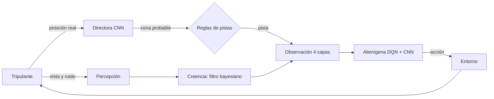
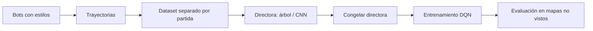

# Arquitectura

Xenomorfo-Q tiene cuatro partes. Cada una vive en su propio paquete y se comunica con las demás solo a través de las interfaces de [contratos.md](contratos.md).

| Parte | Paquete | Técnica principal | Estado |
|---|---|---|---|
| Simulación | `sim/` | Cuadrícula, BFS, bots | Versión 0: movimiento y captura |
| Directora | `director/` | Aprendizaje supervisado (árbol de decisión y CNN) | Planeada (T15 a T20) |
| Alienígena | `alien/` | A*, filtro bayesiano, árbol de comportamiento, DQN con CNN | Planeada (T21 a T27) |
| Experimentos | `experiments/` | Protocolo de evaluación | Planeada (T28 a T33) |

## Simulación

Mapa en cuadrícula de la estación (paredes, piso, puertas y casilleros), un tripulante movido por bots y un entorno tipo Gym que el alienígena usa para actuar. Ver [entorno.md](entorno.md).

## Directora

Conoce la posición real del tripulante. A partir de sus últimas posiciones predice a qué sala se dirige. Esa predicción no llega directo al alienígena: pasa por reglas de pistas que deciden cuándo dar una pista y la convierten en una zona, nunca en la casilla exacta.

## Alienígena

Primero una versión por reglas (A* para moverse, filtro bayesiano para la creencia sobre la posición del tripulante, árbol de comportamiento para decidir) que sirve como línea base. Después un agente DQN con una CNN que recibe la observación de 4 capas.

## Experimentos

Se mide tasa de captura y tiempo medio de captura en tres casos: sin pistas, pistas por reglas y pistas de la directora. Se evalúa en mapas que no se usaron para entrenar.

## Flujo de datos por tick

1. El alienígena elige una acción a partir de la observación.
2. El entorno mueve al alienígena y luego al tripulante, y revisa si hubo captura.
3. La percepción produce lo que el alienígena ve y oye; el filtro bayesiano actualiza la creencia.
4. La directora recibe la posición real del tripulante y predice la sala probable; las reglas de pistas deciden si se entrega una pista.
5. Se arma la observación de 4 capas (paredes, creencia, alienígena, pista) para el siguiente tick.

En la versión 0 solo existen los pasos 1, 2 y 5; la creencia es uniforme y la capa de pista está en ceros.

## Pipeline de entrenamiento

La directora se entrena primero, con datos generados por bots, y se congela. Solo después se entrena el DQN, con la directora fija. El motivo está en [decisiones.md](decisiones.md).

