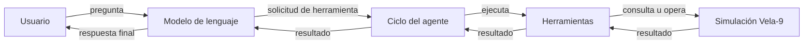
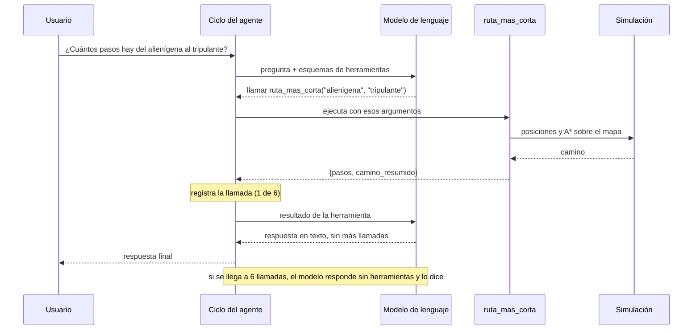

# Arquitectura

Xenomorfo-Q es un agente con herramientas sobre una simulación propia. El usuario pregunta en español, el modelo de lenguaje decide qué herramientas usar, el ciclo del agente las ejecuta sobre la simulación y el modelo arma la respuesta. El contexto de esta decisión está en [propuesta.md](propuesta.md) y en la decisión D8 de [decisiones.md](decisiones.md).

| Parte | Ubicación | Estado |
|---|---|---|
| Simulación | `sim/` | Existe: mapa, salas, entorno, visión (T08), rutas con A* (T09) y avance con eventos (T10). |
| Herramientas | `director/herramientas.py` | Planeado (T11 a T13). |
| Agente | `director/agente.py` y `director/llm.py` | Existe (T14, T15, T17). |
| Alienígena por reglas | `alien/reglas.py` | Existe (T18, T19). Ver [alien.md](alien.md). |
| Casos de prueba y notebook | `experiments/` y notebook | Planeado (T20 a T24). |

Las interfaces de cada parte están en [contratos.md](contratos.md).

## Flujo de una pregunta

## El ciclo del agente

El ciclo se adapta de `run_agent_with_budget` de los notebooks del curso (Lecture11) y está en `director/agente.py` (`ejecutar_agente`). El detalle está en [contratos.md](contratos.md#6-agente).

1. Envía al modelo el prompt de sistema, la pregunta y los esquemas de las seis herramientas, con temperatura 0.
2. Si el modelo pide herramientas, el ciclo las ejecuta, registra cada llamada (herramienta, argumentos, resultado, tiempo y si hubo error) y le devuelve los resultados.
3. Repite hasta que el modelo responde en texto o se ejecutan 6 herramientas. El límite cuenta herramientas ejecutadas, no turnos del modelo ([D9](decisiones.md#d9-el-límite-de-llamadas-cuenta-herramientas-ejecutadas)): si un turno pide más de las que quedan, las sobrantes no se ejecutan.
4. Al llegar al límite, hace una última llamada sin herramientas: el modelo responde con lo que ya sabe y dice que alcanzó el límite.

Un error de herramienta (nombre inexistente, argumentos inválidos o una excepción) no rompe el ciclo: llega al modelo como JSON `{"error": ...}` para que pueda corregir.

El límite evita ciclos largos y costos inesperados, y deja una traza que se puede revisar en los casos de prueba.

## Cómo una pista afecta al alienígena

`dar_pista(sala)` no mueve al alienígena: deja registrada una sala objetivo y descuenta una de las 3 pistas de la partida. En cada tick el alienígena por reglas decide así:

1. Si ve al tripulante, lo persigue.
2. Si lo perdió de vista, va a la última casilla donde lo vio.
3. Si no lo ve y tiene una pista vigente, va al centro de esa sala con A*. Al llegar, la pista se cumple.
4. Si no, patrulla los centros de las salas.

El detalle está en [alien.md](alien.md) (`alien/reglas.py`, T18 y T19).

Por eso el efecto de una pista solo se nota al avanzar la simulación con `avanzar_simulacion(ticks)`.
